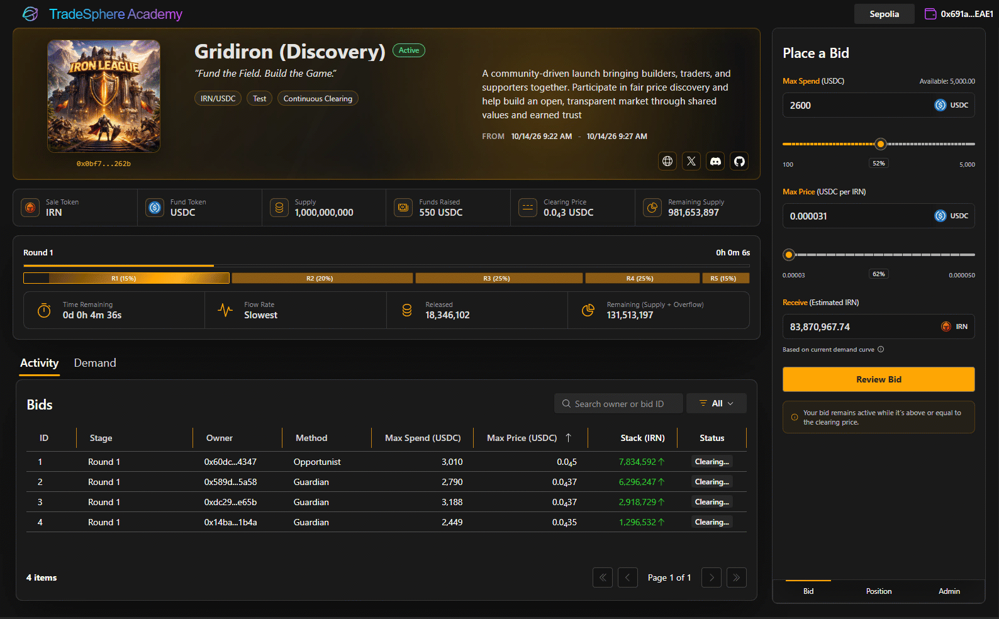

# TradeSphere Academy

**On-Chain Auctions · Continuous Price Discovery · Market-Driven Token Launches**

**Great projects need more than great ideas. They need an economy.**

TradeSphere Academy helps projects launch token economies through on-chain auctions, market-driven funding, price discovery, and community participation.

Built on **Uniswap's Continuous Clearing Auction (CCA)** protocol, Academy provides the infrastructure to design, test, operate, and participate in token launches.

Our approach goes beyond a single auction. Projects can distribute tokens progressively, raise capital, establish liquidity, and develop their markets through staged campaigns.

**Working software. Real blockchain transactions. Observable results.**

*TradeSphere Academy — on-chain auctions powered by Uniswap CCA.*

## Why Academy?

**Launching a token is an event. Building an economy is a process.**

An initial token sale may establish a price, but projects need more than a launch event to succeed. They need participants, capital, liquidity, and opportunities to grow.

Academy provides a structured approach to building that foundation.

Projects can:

- Introduce token supply through competitive on-chain auctions.
- Discover prices through actual bids rather than arbitrary valuations.
- Raise capital as development progresses.
- Establish and expand secondary-market liquidity.
- Attract participants through successive campaign stages.
- Test economic strategies before committing real assets.

Participants can discover emerging projects, bid for tokens, develop strategies, and take part in building new economies.

### And Then Comes Graduation

Academy isn't the destination. It's the beginning.

Projects that establish their economic foundation can expand into the broader TradeSphere ecosystem, using infrastructure for organizations, Actors, activities, and participation markets.

**Projects remain independent.** They retain ownership and control of their tokens, organizations, communities, subscribers, and economic relationships.

Graduation into TradeSphere is an opportunity, not a requirement.

**Your project. Your economy. Your future.**

---

## One Academy Auction. Multiple Uniswap CCAs.

A conventional token launch often involves one auction followed by liquidity pool creation.

Academy's evolving campaign model introduces a broader approach: an **Academy Auction** coordinates multiple independently executed Uniswap CCAs.

Each stage has its own bidding, clearing, settlement, exits, and claims.

Completed stages contribute to the campaign's cumulative results, allowing future auction configurations and schedules to respond to actual participation.

Every stage must meet its published minimum funding requirement to graduate. If it fails, the current campaign concludes.

The objective is not to guarantee success or eliminate market risk. It is to provide a repeatable, market-driven framework for launching and developing token economies.

*Individual CCA execution is operational. Unified campaign orchestration and adaptive progression are planned extensions.*

### Liquidity & Treasury Growth

A successful initial mainnet auction can establish the project's first Uniswap liquidity pool.

Subsequent auctions can contribute additional assets to the existing pool and increase treasury reserves.

This allows funding and market liquidity to develop throughout a campaign instead of depending entirely on the initial launch.

**The auction launches the market. The campaign helps build the economy.**

---

## Featured Campaign — Gridiron: The Reckoning

We're putting Academy to work on our own projects first.

**Gridiron: The Reckoning** is a five-stage campaign introducing the IRN token economy through progressive distribution, funding, and participation.

| Stage | Network | Purpose | Liquidity |
|---|---|---|---|
| **01 — Discovery** | Ethereum Sepolia | Participation and qualification | — |
| **02 — Confidence** | Arbitrum One | Initial funding and price discovery | Launch initial pool |
| **03 — Momentum** | Arbitrum One | Continue controlled distribution | Add liquidity |
| **04 — Expansion** | Arbitrum One | Broaden participation and capital formation | Add liquidity |
| **05 — Peak** | Arbitrum One | Complete the planned campaign allocation | Add liquidity |

Each stage advances only if its predecessor graduates. Subsequent stages can contribute additional assets to the existing liquidity pool and project treasury.

### Discovery — Learn, Participate, Qualify

Discovery operates on **Ethereum Sepolia** using test assets and actual blockchain transactions.

Participants can experience the auction, place bids, and establish eligibility for matching rewards during Confidence without committing real purchase funds.

**Qualification requires auction participation, not simply connecting a wallet.**

### Confidence — Real Participation, Real Incentives

Confidence is the planned first **Arbitrum One mainnet auction**, conditional on Discovery meeting its progression requirements.

Participants can purchase IRN through Uniswap CCA, with two additional incentives:

- **IRN Matching Rewards:** Qualified Discovery participants who make eligible settled Confidence purchases can receive additional IRN. Matching is proportional when qualifying demand exceeds the available reward reserve.
- **USDC + IRN Bonus Lottery:** Eligible Confidence participants can qualify for a bonus calculated from 3% of settled USDC proceeds, together with an equivalent IRN amount based on the final clearing price. Discovery participation is not required for lottery eligibility.

The campaign reserves **5 billion IRN** for the IRN bonus and proportional matching rewards.

Matching eligibility requires the same wallet address used during Discovery and a qualifying settled Confidence purchase within the published limits.

The lottery, matching distributions, and final eligibility rules are subject to the applicable campaign conditions.

**[Rewards & Qualification](docs/rewards.md)**

---

## Powered by Uniswap CCA

Academy uses **Uniswap Continuous Clearing Auctions** for on-chain token distribution and price discovery.

Participants submit bids specifying their spending limits and maximum acceptable prices.

Tokens become available over time according to the auction's configured distribution schedule. Competing bids influence the clearing price and allocations.

Academy makes that execution visible through:

- Live auction metrics and clearing prices
- Round-based token flow visualization
- Wallet-connected bidding and position management
- Realized and unrealized allocation calculations
- On-chain settlement and claims
- Scenario testing, automated test bots, and replay

*Academy Test execution — configurable rounds, token flow, automated bidding, and continuous clearing.*

**Uniswap provides the auction protocol. Academy provides the tools to configure, operate, and understand it.**

[Detailed Auction Mechanics](docs/auction.md) · [Uniswap CCA Documentation](https://developers.uniswap.org/docs/liquidity/liquidity-launchpad/overview)

---

## Built with Modern .NET & Ethereum Technology

Academy combines a predominantly C# application stack with Ethereum-compatible smart contracts on Sepolia and Arbitrum One, and participant-controlled wallets.

| Technology | Role |
|---|---|
| **.NET 10 / Blazor Server** | Interactive application and server-managed services |
| **Fluent UI Blazor 5** | Component framework and user interface |
| **Nethereum** | Blockchain integration, contract operations, and managed transactions |
| **Reown** | Connected-wallet authorization and transactions |
| **Uniswap CCA** | On-chain auction execution and price discovery |
| **Ethereum Sepolia** | Discovery auction and on-chain testnet validation |
| **Arbitrum One** | Production auctions and mainnet settlement |
| **Infura** | Blockchain RPC infrastructure |
| **Microsoft Azure** | Application hosting |

Academy uses **Blazor Server** to coordinate auction state, calculations, monitoring, and real-time UI updates. JavaScript and Reown handle participant wallet interactions directly in the browser.

Centralized blockchain monitoring reduces redundant RPC activity across connected participants.

We've also upgraded to **Fluent UI Blazor 5**, combining Microsoft's Fluent components with Academy's custom auction controls, visualizations, and market interfaces.

[Technology Stack](docs/technology.md) · [Architecture](docs/architecture.md)

---

## Scenarios, Test Bots & Replay

A successful auction launch requires more than a working smart contract. It requires understanding how the auction behaves under different conditions.

Academy's scenario executor supports three environments:

| Environment | Purpose |
|---|---|
| **Test** | Accelerated off-chain simulation and evaluation |
| **Sim** | On-chain testnet validation using real contracts and test assets, including Ethereum Sepolia |
| **Live** | Arbitrum One mainnet execution with real economic commitments |

Scenarios can progress from **Test → Sim → Live**, preserving their distribution strategy while applying the appropriate network configuration.

### Behavioral Test Bots

Academy includes controlled test bots with configurable bidding strategies and behavioral models.

The framework incorporates five bidding strategies, sixteen Myers-Briggs personality profiles, four temperaments, and quantitative behavioral biases.

These models introduce variation in participation, price sensitivity, spending, and competitive behavior.

**Academy test bots are not independent external Agents.** They are controlled participants used for simulation, testing, and validation.

TradeSphere already operates bots and scenarios across Ideas, Missions, and Games. Academy's enhanced behavioral model is designed to extend those existing capabilities.

### Replay & Verification

Auction execution can be reconstructed and replayed, allowing calculated results to be compared against recorded activity.

Test bots, scenario administration, and replay are implemented capabilities that currently remain restricted to administrators.

[Test Bots & Scenarios](docs/bots.md)

---

## Built First. Proven Through Use.

Academy is operational, with public access focused on discovering and participating in existing auctions.

The underlying application already supports token and auction creation, scenario configuration, automated testing, blockchain execution, and replay.

These creation and administration capabilities remain restricted during the initial launch period.

We're using the IRN campaign to validate the technology and economic approach through actual participation before expanding access to other projects.

**We're building the infrastructure we intend to use—and making it available for others to build on.**

---

## Documentation

| Document | Description |
|---|---|
| [Architecture](docs/architecture.md) | Application structure, campaign model, registration, and services |
| [Auction Mechanics](docs/auction.md) | Continuous clearing, bidding, flow, allocations, and settlement |
| [Technology Stack](docs/technology.md) | Frameworks, blockchain integration, and hosting |
| [Test Bots & Scenarios](docs/bots.md) | Behavioral simulation, Test/Sim/Live, and replay |
| [Rewards & Qualification](docs/rewards.md) | Discovery eligibility, Confidence matching, and bonus lottery |

## Where's the Code?

TradeSphere Academy's application source is currently maintained in a private development repository.

This repository presents the architecture, technology, implementation details, and demonstrations of the working system.

Selected libraries, components, and integration interfaces may be released separately as they become ready.

**The software is real. The source is private for now.**

---

## Explore TradeSphere

**[TradeSphere Website](https://www.tradesphere.org)** — Explore the ecosystem and its applications.

**[TradeSphere GitHub Organization](https://github.com/TradeSphere-org)** — Projects, architecture, and technical documentation.

**[Uniswap CCA](https://developers.uniswap.org/docs/liquidity/liquidity-launchpad/overview)** — The underlying auction protocol.

**[Fluent UI Blazor](https://www.fluentui-blazor.net/)** — The application component framework.

**[Discord](https://discord.gg/QkJqp4snHQ)** — Community and discussion.

**Contact:** [info@tradesphere.com](mailto:info@tradesphere.com)

---

**TradeSphere™ — Participation Markets for Humans and Autonomous Agents.**