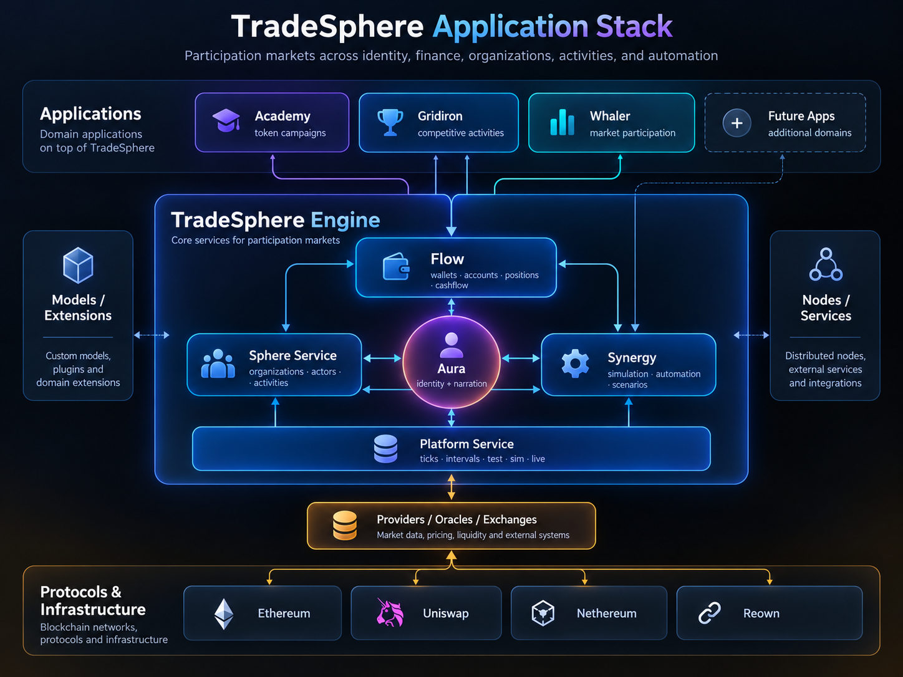
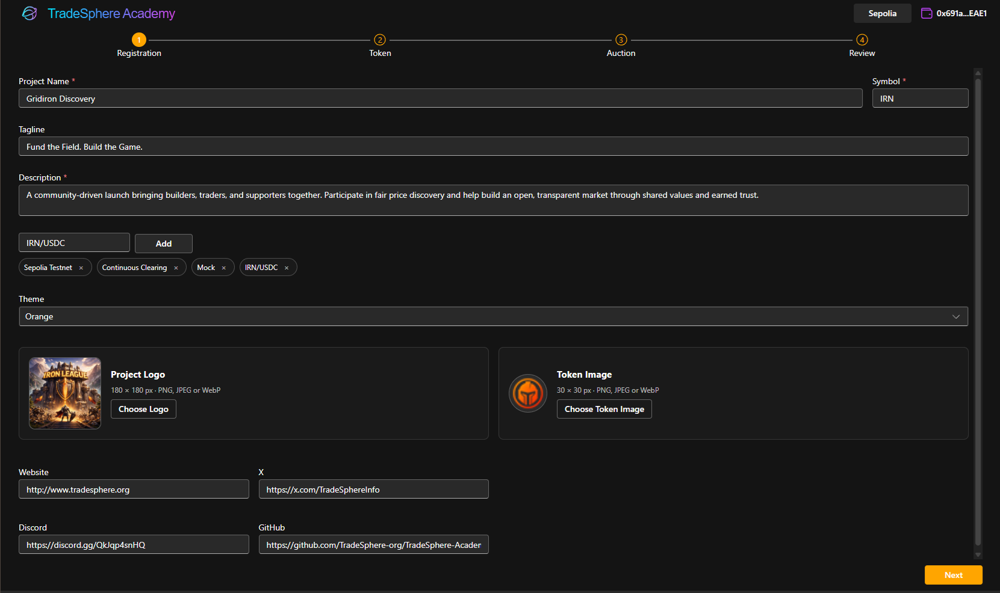

# TradeSphere Academy — Architecture

## Overview

TradeSphere Academy is a .NET-based application for creating, configuring, testing, and operating on-chain token auctions using **Uniswap's Continuous Clearing Auction (CCA)** protocol.

Academy combines token and auction creation, project registration, scenario-driven execution, blockchain integration, market visualization, and replay.

Its purpose is to help projects establish their initial token economies through market-driven funding, distribution, price discovery, and community participation.

Academy operates independently of TradeSphere's broader organizational model. Projects retain ownership and control of their tokens, organizations, participants, and economic relationships.

**TradeSphere provides the infrastructure. Projects build their own economies.**

*TradeSphere application stack — applications, core services, and supporting infrastructure.*

---

## Current Availability

Academy is operational as a standalone application, with public access focused on participating in existing auctions.

Its creation, scenario execution, and administrative capabilities are implemented but currently restricted.

| Capability | Availability |
|---|---|
| Auction discovery and participation | Public |
| Wallet connection and on-chain bidding | Public |
| Auction monitoring, token flow, and positions | Public |
| Auction settlement and claims | Supported through the auction lifecycle |
| Auction registration and creation | Implemented — restricted |
| New token creation and existing token integration | Implemented — restricted |
| Scenario configuration | Implemented — restricted |
| Test, Sim, and Live environments | Implemented — restricted administration |
| Automated test bots | Implemented — restricted |
| Replay and result verification | Implemented — restricted |
| Auction administration | Implemented — restricted |
| General project access to creation tools | Planned |
| Unified Academy Auction campaign orchestration | Planned |
| TradeSphere Activity integration | Future |

### Initial Launch Validation

Academy is being validated through TradeSphere's own projects before expanding access.

The inaugural campaign, **Gridiron: The Reckoning**, establishes two initial milestones:

- **01 — Discovery:** On-chain qualification and validation using Ethereum Sepolia and test assets.
- **02 — Confidence:** The first Arbitrum One mainnet auction, contingent on sufficient participation and successful Discovery validation.

Successful completion of these stages is the intended milestone for expanding access to Academy's creation and scenario capabilities.

The objective is to demonstrate the technology through actual execution before opening it to additional projects.

---

## Application Architecture

Academy uses a server/browser architecture that separates application orchestration, blockchain monitoring, and transaction authorization.

### Blazor Server & .NET 10

Academy is built with **.NET 10, Blazor Server, and Fluent UI Blazor**.

The application uses strongly typed C# domain models and services for auction registration, configuration, execution, calculations, and presentation.

Blazor Server provides:

- Component-based interfaces for auctions, bids, positions, and market visualization.
- Direct integration with .NET domain models and application services.
- Centralized blockchain synchronization and auction calculations.
- Shared application state and updates for connected participants.
- Reduced redundant RPC requests compared with independent browser polling.

JavaScript and Reown handle browser wallet operations.

The current architecture does not require a Blazor WebAssembly client.

### Blockchain Integration & Transaction Execution

Academy uses **Nethereum** and **Reown** for Ethereum-compatible blockchain integration.

The transaction path depends on the account responsible for authorization.

| Operation | Execution |
|---|---|
| Read-only blockchain operations | Nethereum |
| Participant bidding | Reown / connected wallet |
| Participant exiting and claiming | Reown / connected wallet |
| System-managed bidding | Nethereum |
| System-managed exits and claims | Nethereum |
| Auction creation | User-authorized or system-managed |
| Administrative operations | User-authorized or system-managed |

Connected participants authorize transactions through their own wallets.

System-managed operations use accounts controlled by the appropriate application services.

**The distinction is who authorizes the transaction, not which contract is being accessed.**

Uniswap CCA smart contracts remain authoritative for auction execution, clearing, and settlement.

### Application Services

Academy's application services coordinate:

- Auction registration, configuration, and deployment
- Contract interaction and transaction execution
- Blockchain monitoring and synchronization
- Auction checkpoints and clearing calculations
- Bid and position management
- Scenario execution and controlled test bots
- Reconstruction, replay, and verification

Application-side calculations support monitoring and analysis without replacing authoritative on-chain execution.

For the technologies and transaction architecture, see [Technology Stack](technology.md).

---

## Academy Auction Campaign Model

Academy's evolving campaign architecture introduces a coordinating level above individual Uniswap CCA auctions.

An **Academy Auction** represents a campaign containing an ordered series of independently executed CCAs.

### Hierarchical Structure

**Academy Auction → CCA Stage → Distribution Steps**

| Component | Responsibility |
|---|---|
| **Academy Auction** | Campaign identity, allocation, scheduling, graduation, and cumulative economic state |
| **CCA Stage** | Individual auction configuration, execution, settlement, exits, and claims |
| **Distribution Steps** | Token flow and supply distribution within an individual CCA |

The campaign coordinates progression, while each underlying CCA retains its own smart contract execution and settlement lifecycle.

### Campaign Progression

Each completed CCA contributes results to the campaign.

A stage must meet its published minimum funding requirement to graduate. Failure terminates the current campaign, although the project can initiate another Academy Auction later.

Successful stage results can inform the configuration and timing of future CCAs without changing the terms of an active auction.

### Liquidity & Treasury Development

The Reckoning illustrates how campaign progression can support continued market development.

Following successful Confidence graduation, the project intends to establish its initial Uniswap liquidity pool.

Subsequent stages can contribute additional assets to that liquidity pool while increasing treasury reserves.

This allows liquidity and project funding to develop progressively throughout the campaign.

### Relationship to TradeSphere Campaigns

The campaign model follows an architectural pattern already established within TradeSphere.

A **CampaignActivity** contains **CampaignDirectives** that coordinate individual **AuctionActivities**.

Directives provide scheduling and progression information, including timing, confidence, and consensus.

A similar pattern applies to Gridiron's tournament model, where tournament coordination organizes individual game activities.

Academy's campaign orchestration can remain independent while preserving compatibility with TradeSphere's broader Activity framework.

### Implementation Status

Individual CCA creation, execution, scenario evaluation, and replay are implemented.

Unified Academy Auction orchestration, adaptive stage scheduling, cumulative campaign state, and graduation management remain planned extensions.

The existing CCA contracts do not need to be replaced to introduce this coordination layer.

For campaign behavior, graduation, and auction mechanics, see [Auction Mechanics](auction.md).

---

## Auction Registration & Creation

*Academy's registration workflow for project identity, token configuration, and auction creation. Currently restricted to administrative use.*

Academy organizes project and auction creation through an **AuctionRegistration** model.

Each registration contains three primary components:

| Component | Responsibility |
|---|---|
| **Profile** | Project identity, description, and presentation |
| **Config** | Token information, supply, pricing, duration, contract parameters, and deployment configuration |
| **Scenario** | Distribution strategy, token flow, rounds, and execution behavior |

This separation allows a project's identity, auction configuration, and execution strategy to evolve independently.

### Profile

The Profile contains the descriptive information used to identify and present a project and its auction.

It provides the foundation for future project discovery without requiring a project to adopt TradeSphere's organizational model.

### Config

Config defines the auction's economic and contract parameters.

These include:

- Base and quote tokens
- Token supply and auction allocation
- Floor price and pricing parameters
- Auction duration, start, and end times
- Claim timing
- Minimum funding requirements
- Recipient addresses
- Contract deployment settings

**Duration and Floor Price are configuration parameters, not properties of the Scenario.**

Config establishes the operating constraints under which the auction executes.

### Scenario

Scenario defines how the configured auction operates over time.

It includes:

- Token distribution strategy
- Supply allocation across rounds or steps
- Token flow rates
- Round structure and relative timing
- Automated test bot populations and behavioral assignments
- Execution and participation rules used for scenario evaluation

The Scenario works within the boundaries established by Config, including the configured auction duration and floor price.

This allows different distribution and participation strategies to be tested without changing the project's identity or duplicating contract configuration.

### Token Creation & Integration

Academy supports creating new tokens and integrating existing tokens.

Projects can configure token and auction contracts through the registration workflow.

Token creation and auction deployment are implemented but currently restricted to administrative use.

### Registration & Project Discovery

Registration provides the foundation for a future community-driven token and project registry.

The intended model allows independent projects to introduce their tokens and make their markets discoverable without requiring centralized approval of their economic value.

Participants can evaluate projects using observable activity, market participation, and transaction history.

Public registration and community discovery remain future capabilities.

**Trust is earned through transactions, participation, and demonstrated behavior—not bestowed through platform approval.**

---

## Scenario Execution Architecture

Academy's scenario executor supports evaluating auction behavior before committing real assets.

The same general execution model operates across three environments.

| Environment | Execution | Purpose |
|---|---|---|
| **Test** | Mock, off-chain | Accelerated execution and scenario evaluation |
| **Sim** | On-chain testnet | Contract validation using test assets |
| **Live** | Arbitrum One mainnet | Real auction execution and economic commitments |

Scenarios can be cloned from **Test → Sim → Live**, with network-specific assets, contract addresses, and deployment configuration applied as appropriate.

### Controlled Test Bots

Academy uses controlled test bots to exercise auction execution under different bidding conditions.

Its behavioral framework includes bidding strategies, Myers-Briggs personality profiles, temperaments, and quantitative behavioral biases.

These bots are part of Academy's testing infrastructure, not independent external Agents.

System-managed transactions are executed through Nethereum where blockchain interaction is required.

### Replay & Verification

Academy can reconstruct auction execution and compare its calculations against recorded results.

Replay supports analysis of clearing, allocations, checkpoints, and settlement across Test, Sim, and Live.

Scenario administration, bot execution, and replay are implemented but remain restricted to administrative use.

For scenario design, behavioral modeling, and execution details, see [Test Bots & Scenarios](bots.md).

---

## Relationship to TradeSphere

Academy is a standalone application. It does not require projects or participants to adopt TradeSphere's broader organizational architecture.

The TradeSphere Engine provides a larger participation model built around:

| Component | Responsibility |
|---|---|
| **Organizations** | Independent economic and operational groups |
| **Actors** | Human and automated participants |
| **Activities** | Structured environments for participation |
| **Directives** | Coordinated decisions, signals, and commitments |
| **Actions** | Participant behavior and execution |

Supporting services include **Platform Service, Sphere Service, Aura, Flow Service, and Synergy Service**.

### Existing TradeSphere Capabilities

TradeSphere already has operational scenarios and bots executing **Ideas, Missions, and Games**.

These capabilities are part of its existing Activity framework.

Academy extends the same general scenario-driven approach with specialized auction execution and more sophisticated behavioral models.

The enhanced behavioral framework can be integrated into TradeSphere's existing bots without redesigning the scenario infrastructure.

### Planned Integration

Future integration will allow Academy auctions to operate within TradeSphere's broader **Activity → Directive → Action** model.

Auction activity can then contribute to organizational participation, confidence, consensus, and reputation systems.

This integration is an extension, not a dependency.

Projects retain ownership and control of their tokens, assets, participants, and economic relationships regardless of their participation in the broader TradeSphere ecosystem.

**Academy provides the launch infrastructure. Projects decide what comes next.**

---

## Design Principles

**Independent projects.** Projects retain control over their assets, communities, and economic relationships.

**Established protocols.** Use Uniswap CCA for authoritative on-chain auction mechanics rather than developing an unnecessary replacement.

**Separation of concerns.** Keep project identity, auction configuration, scenario behavior, and campaign orchestration distinct.

**Flexible authorization.** Support connected-wallet participation and system-managed execution through appropriate accounts.

**Scenario-driven validation.** Evaluate auction configurations through mock execution and real blockchain environments.

**Observable execution.** Support monitoring, reconstruction, and replay for understanding and verifying auction behavior.

**Composable infrastructure.** Build reusable services and domain models that can extend into the broader TradeSphere platform.

---

## Related Documentation

- [Auction Mechanics](auction.md)
- [Technology Stack](technology.md)
- [Test Bots & Scenarios](bots.md)
- [Rewards & Qualification](rewards.md)
- [Uniswap CCA Documentation](https://developers.uniswap.org/docs/liquidity/liquidity-launchpad/overview)
- [Fluent UI Blazor](https://www.fluentui-blazor.net/)