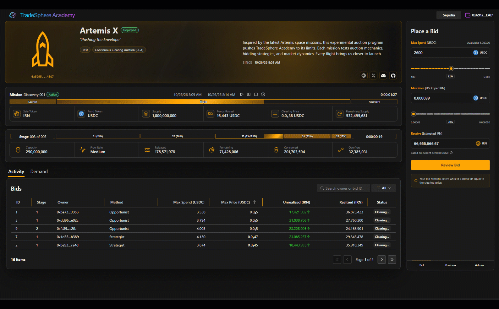

# TradeSphere Academy — Auction Mechanics

## Overview

TradeSphere Academy uses **Uniswap's Continuous Clearing Auction (CCA)** protocol for on-chain token distribution and price discovery.

Participants bid for tokens as supply is released over time. Clearing prices and allocations respond to demand under the protocol's rules.

Academy extends CCA with configurable distribution scenarios, automated participants, real-time visualization, live monitoring, and replay.

Academy can also connect to existing Uniswap CCA auctions by contract address, including auctions deployed outside Academy.

**Uniswap provides the auction protocol. Academy provides the tools to configure, operate, monitor, and understand it.**

---

## Campaigns, Phases & Auction Attempts

An initial auction can help a project discover its market, while a larger project may choose several phases to build participation, funding, and liquidity progressively. **Academy doesn't require a multi-auction campaign**: a single auction may be the entire plan.

### Campaign → Phase → Attempt → Auction Stages

| Level | Responsibility |
|---|---|
| **Campaign** | Project-defined overall objectives and distribution plan |
| **Phase** | Milestone and published graduation requirements |
| **Attempt / CCA instance** | Individual auction execution, clearing, settlement, exits, and claims |
| **Scenario** | Reusable strategy chosen for each attempt |
| **Auction Stage** | Portion of an auction's distribution schedule with its own flow rate |

A phase may have multiple attempts. If one attempt doesn't achieve the objective, a project can repeat the scenario or try a different approach, subject to its rules. A failed **attempt** does not automatically mean a failed **phase**. An active auction's terms stay governed by its deployed contract.

### Gridiron — The Reckoning

Gridiron is Academy's first featured project, introducing the IRN token economy through **five campaign phases**.

| Phase | Network | Purpose | Liquidity |
|---|---|---|---|
| **01 — Discovery** | Ethereum Sepolia | Qualification through the Discovery auction | — |
| **02 — Confidence** | Arbitrum One | Real-USDC funding through the Confidence auction | Planned initial pool |
| **03 — Momentum** | Arbitrum One | Further controlled distribution | Potential additions |
| **04 — Expansion** | Arbitrum One | Broaden participation and capital formation | Potential additions |
| **05 — Peak** | Arbitrum One | Complete the planned campaign allocation | Potential additions |

#### The Discovery Auction — Live Test AuctionN

The Discovery auction runs on **Ethereum Sepolia**, using
**test USDC and test IRN**.

Designed as a qualification auction, it provides an extended
participation window to attract bidders and establish community
interest before advancing to the Confidence phase.

Minimum and maximum bidder limits define the participation
requirements. The Discovery auction must meet its minimum
qualification threshold for the campaign to advance.

Participants experience real blockchain transactions and
continuous price discovery without committing real purchase funds.

Participation in the Discovery auction also establishes eligibility
for additional IRN matching rewards through qualifying purchases
in the Confidence auction.

**[Explore the Gridiron Auction](https://academy.tradesphere.org/gridiron)**

#### The Confidence Auction — Planned Mainnet Auction

The Confidence auction is planned for **Arbitrum One**, using real USDC to purchase IRN. Its launch depends on the Discovery auction reaching the minimum participation requirement. Intended qualifying purchases are **100–5,000 USDC**; matching rewards and a bonus lottery are subject to published eligibility and settlement rules.

See [Rewards & Qualification](rewards.md). Unified campaign/phase orchestration is planned; individual CCA execution is operational.

---

## Continuous Clearing Mechanics

A CCA releases a configured token supply over a defined period.

Participants submit bids specifying how much they are willing to spend and the maximum price they will accept.

As supply becomes available, the protocol determines allocations from the active bids.

The clearing price is nondecreasing: it may remain unchanged or increase, but cannot move backward.

| Concept | Description |
|---|---|
| **Base Token** | Token being distributed |
| **Quote Token** | Asset used to purchase the base token |
| **Supply** | Total base tokens allocated to the CCA |
| **Floor Price** | Minimum clearing price |
| **Spending Cap** | Maximum quote-token commitment |
| **Price Ceiling** | Highest price accepted by a bidder |
| **Clearing Price** | Price determined by qualifying demand and available supply |
| **Flow Rate** | Rate at which auction tokens become available |
| **Fill** | Tokens allocated to a bid |
| **Checkpoint** | Recorded cumulative auction execution state |

The smart contracts remain authoritative for clearing and settlement. Academy maintains corresponding calculations for monitoring, simulation, and verification.

---

## Auction Stages & Token Flow

Academy organizes each CCA's token distribution schedule into **stages**.

A stage has a defined duration and allocation of the auction's supply. Its flow rate depends on the relationship between those values.

### Distribution Example

| Stage | Duration Share | Supply Share |
|---|---:|---:|
| 1 | 20% | 15% |
| 2 | 20% | 20% |
| 3 | 20% | 25% |
| 4 | 20% | 25% |
| 5 | 20% | 15% |

*Illustrative configuration. Equal stage durations produce flow rates proportional to the allocated supply.*

### Flow Visualization

*Live auction clip: Stage 3 transitions into Stage 4, showing changes in token flow, remaining supply, and clearing information. *

The flow indicator displays the active stage, its relative release rate, allocated supply, and remaining tokens.

Stages describe changes in distribution conditions, not independent auctions.

### Realized & Unrealized Allocations

Allocations have distinct states during execution.

**Unrealized**

Current-stage fills remain subject to changing bid competition and clearing conditions.

**Realized**

At a completed stage boundary, that stage's fills are established. A bid may be partially or fully filled.

**Continued Allocation**

Eligible bids can receive additional fills in subsequent stages.

A participant's cumulative allocation can therefore include both realized fills from completed stages and unrealized fills from the current stage.

This distinction describes the auction calculations. Separate realized and unrealized position fields and UI presentation are planned enhancements.

---

## Bidding & Price Discovery

Participants connect their wallets and place bids using the auction's quote token.

Each bid specifies two principal constraints:

- **Spending Cap:** The maximum quote-token amount committed.
- **Price Ceiling:** The maximum price the participant accepts for the base token.

### Bid Submission

1. Connect a supported wallet and select the appropriate network.
2. Review the auction's current clearing price and bid conditions.
3. Configure the spending cap and price ceiling.
4. Authorize any required ERC-20 allowances, including Permit2 where applicable.
5. Submit the transaction through the connected wallet.

Academy uses Reown for participant-authorized transactions and Nethereum for system-managed transactions, including automated bidding.

Both paths interact with the same CCA contracts.

### Bid Competition

As bids enter the auction, the available supply is allocated according to the protocol's clearing rules.

When demand exceeds supply at the current clearing price, the clearing price can advance.

Bids below the clearing price stop qualifying for additional allocation. Bids with higher price ceilings can remain eligible.

Within an active stage, additional bids can displace unrealized allocations before that stage's fills are established.

### Bid Status

Academy presents the following active bid conditions:

| Status | Meaning |
|---|---|
| **Clearing** | Currently qualifying for allocation |
| **Partial** | Receiving less than the requested allocation |
| **Outbid** | Not currently qualifying for allocation |

After the auction closes, final outcomes are represented as **Cleared**, **Partial**, or **Outbid**.

Bid status and allocation are related but distinct: a bid may already have realized fills from completed stages even if its remaining demand becomes outbid.

---

## Checkpoints & Monitoring

Uniswap CCA checkpoints represent cumulative execution state.

Academy reads contract state and checkpoints to monitor auction progress and reconstruct clearing calculations.

Relevant information includes:

- Blockchain position and execution progress
- Cumulative token distribution
- Clearing price
- Funds raised
- Allocation calculations

### Blockchain Synchronization

Academy centralizes blockchain monitoring through shared application services.

This reduces redundant RPC traffic from connected browsers and provides a consistent application model.

The interface can update its clock and presentation between blockchain observations, while authoritative contract state follows confirmed on-chain execution.

### Numeric Calculations

Academy's .NET services use Nethereum and calculation utilities for contract data, token decimals, and fixed-point prices, including Q96 representations.

These calculations support monitoring and replay without replacing the smart contracts as the authoritative source.

For execution environments and automated validation, see [Bots & Scenarios](bots.md).

---

## Connecting to Existing Uniswap CCA Auctions

Academy can load existing Uniswap CCA auctions directly using their deployed contract addresses, including auctions created outside Academy.

This allows Academy to operate as a monitoring and analysis environment independently of its auction creation workflow.

### Live Monitoring

Once an existing CCA is loaded, Academy can reconstruct its execution state from blockchain data and monitor the auction as it progresses.

The loaded auction can be examined using Academy's existing capabilities, including:

- Auction configuration and distribution schedule
- Clearing prices and token flow
- Bids and participant positions
- Checkpoint-based execution calculations
- Auction progress and settlement state

### Auction Replay

Academy can also replay existing auction activity using recorded blockchain state and its auction calculation engine.

Replay provides an opportunity to examine historical execution, observe changes in clearing conditions, and compare reconstructed calculations against recorded on-chain results.

This is useful for technical analysis, testing, verification, and understanding the behavior of independently deployed CCAs.

### Availability

**Loading external CCA contracts, live monitoring, and replay are implemented capabilities currently restricted to administrators.**

These capabilities do not require the original auction to have been created through TradeSphere Academy.

---

## Auction Lifecycle & Settlement

An individual CCA progresses through the following application states.

| State | Description |
|---|---|
| **Pending** | Awaiting the configured start |
| **Active** | Auction execution and eligible bidding are underway |
| **Ended** | The auction period has completed |
| **Claimable** | Applicable claim operations are available |
| **Settled** | Auction-level settlement has completed |

These states describe the auction itself. Participant positions have separate settlement responsibilities.

### Auction Settlement

Auction settlement completes the auction's required accounting and transfers of funds and tokens according to the contract rules.

Final clearing results establish the economic outcomes.

### Position Settlement

Individual participants may still have outstanding exits, refunds, or token claims after the auction has settled.

**A settled auction does not imply that every participant has claimed their balances.**

Academy supports both connected-wallet and system-managed exit and claim transactions, subject to the relevant contract conditions.

### Exits & Claims

Participants can exit eligible bids or reclaim balances when the contract permits.

Claims transfer the resulting token allocations or refundable quote-token balances according to the auction's settlement rules.

These operations are independent for each CCA stage. Participants do not need to wait for the entire Academy Auction campaign to conclude.

---

## Positions & Allocations

Academy consolidates participant bids into position summaries.

Position information includes:

- Committed funds
- Average purchase price
- Bid count and status
- Token allocations
- Quote-token and base-token settlement balances

### Allocation Accounting

At any point during an active auction:

`Total Filled Amount = Realized Amount + Unrealized Amount`

Realized amounts originate from completed stages. Unrealized amounts represent current-stage allocations that may still change.

At the end of the auction, the cumulative allocation is finalized under the contract's clearing rules.

The distinction between realized allocations, auction settlement, and individual claims is important:

- **Realized:** Allocation established through completed stages.
- **Settled:** Final auction accounting completed.
- **Claimed:** The participant has executed the applicable claim operation.

A participant may have realized allocations that are not yet claimable, or claimable balances that remain unclaimed.

The planned position-model update will expose realized and unrealized values separately.

---

## Related Documentation

- [TradeSphere Academy](https://academy.tradesphere.org) — Live application
- [Gridiron Discovery Auction](https://academy.tradesphere.org/gridiron) — Public Sepolia test auction
- [Architecture](architecture.md) — Application architecture and creation
- [Technology Stack](technology.md) — .NET, Nethereum, Reown, and supporting technologies
- [Bots & Scenarios](bots.md) — Test, Sim, Live, automation, and replay
- [Rewards & Qualification](rewards.md) — Discovery qualification, Confidence matching, and bonuses
- [Uniswap CCA Documentation](https://developers.uniswap.org/docs/liquidity/liquidity-launchpad/overview)