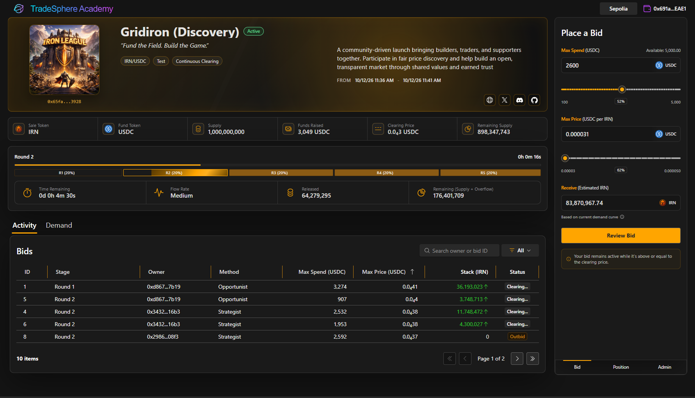

# TradeSphere Academy — Bots & Scenarios

## Overview

TradeSphere Academy supports automated auction participants through its scenario execution framework.

Bots provide a way to evaluate auction behavior under controlled and competitive conditions, helping projects understand how distribution strategies, token flow, bid competition, and clearing prices interact.

Unlike static tests with predetermined inputs, automated participants introduce different bidding behaviors and timing into auction execution.

Academy's bot and scenario capabilities support three execution environments:

- **Test:** Mock, off-chain execution at configurable speeds.
- **Sim:** On-chain execution using test networks such as Ethereum Sepolia.
- **Live:** Mainnet execution using actual blockchain transactions.

Bots, scenario configuration, and execution controls are implemented but currently restricted to administrative use.

## Why Bots?

An auction's behavior depends not only on its configuration but also on how participants respond to changing market conditions.

A distribution schedule that performs well with limited demand may behave differently when bidders compete aggressively for supply.

Automated participants help evaluate those differences.

Bots can be used to investigate:

- Competition for limited token supply
- Clearing price progression
- Bid displacement and partial allocations
- Changes in demand across rounds or steps
- Distribution and flow-rate behavior
- Auction execution under different participant populations
- Calculation and checkpoint consistency
- Reconstruction and replay accuracy

**The objective is to evaluate auction mechanics under varied conditions, not to predict actual market demand.**

## Scenario Configuration

An auction's execution scenario defines the economic environment in which participants operate.

A scenario includes the auction's distribution strategy and parameters governing automated participation.

*Automated participants competing in a configurable mock auction scenario.*

### Auction Parameters

| Parameter | Purpose |
|---|---|
| Allocation | Total token supply committed to the auction |
| Distribution | How supply is divided across the auction |
| Flow | Rate at which tokens become available |
| Rounds / Steps | Intervals with defined distribution characteristics |
| Duration | Total auction operating period |
| Floor Price | Minimum clearing price |
| Bidder Count | Number of automated participants |
| Bid Timing | When automated bids may be submitted |
| Bidder Behavior | Strategy used by each automated participant |

Together, these parameters define the conditions under which a scenario is evaluated.

### Scenario Types

Academy supports configuring different competitive conditions, including:

| Scenario | Behavior |
|---|---|
| UnderSubscribed | Limited demand relative to available supply |
| Balanced | Demand and supply are more closely aligned |
| Competitive | Multiple bidders compete for available allocations |
| LateSurge | Bidding activity increases toward the end |
| WhalePressure | Larger spending commitments influence competition |
| PriceLadder | Bids distributed across different price ceilings |
| Custom | Project-defined execution characteristics |

These scenarios provide starting points for exploring auction behavior.

Projects can modify configurations and evaluate alternatives before advancing to on-chain execution.

## Automated Participants

Academy models automated auction participants as players with configurable bidding behavior.

A player combines participant identity, auction context, and execution strategy.

### Behavioral Strategies

The scenario framework supports several behavioral profiles:

| Behavior | General Strategy |
|---|---|
| Conservative | Lower price tolerance and more cautious bidding |
| Regular | Moderate participation within configured limits |
| Aggressive | Greater willingness to compete at higher prices |
| Reactive | Responds to changing auction conditions |

Behavior influences how an automated participant approaches bid submission and price competition.

Individual bots can be assigned different profiles to create varied competitive conditions within the same scenario.

### Participant Identification

Academy distinguishes human participation from automated participants within its scenario model.

Automated players can be assigned identifiers and descriptive behavioral labels.

Participant identification supports reconstructing auction activity, associating bids with automated players, and analyzing how different strategies perform.

The immediate objective is reliable identification and execution within Academy, rather than full integration with TradeSphere's future Aura identity and reputation services.

### System-Managed Transactions

For on-chain execution, bots can submit transactions through Nethereum using managed accounts.

Supported operations include bidding and, where applicable, exiting and claiming.

Automated transactions remain subject to the same smart contract rules as transactions submitted by connected users.

The transaction execution path differs, but the auction protocol does not distinguish economic rights according to whether a participant is human or automated.

## Bid Timing & Competition

The timing of automated bids matters.

If every participant submits at the same instant, the resulting auction behavior may be less representative of how independent participants interact with changing conditions.

Academy supports distributing bot activity over scenario intervals.

### Round-Based Participation

Bots can operate according to the current round or step.

A scenario may constrain how frequently participants submit bids during an interval.

For example, a configured population could allow each bot one bid per round, with submissions distributed across that round.

This produces a progression of bidding activity rather than a single synchronized burst.

### Randomized Submission Windows

Bot activity can be distributed across configurable time windows.

Randomized timing helps create variation in the sequence of bids and the competitive conditions participants encounter.

This is especially useful when observing the effect of additional bids on clearing prices and provisional allocations.

### Bidding Constraints

Automated participants operate within configured parameters such as:

- Available spending budget
- Maximum accepted price
- Bid frequency
- Current auction state
- Behavioral strategy

These limits allow scenarios to be repeated and compared under controlled assumptions.

## Execution Environments

The same general scenario framework can be evaluated under different execution conditions.

### Test — Mock Execution

Test runs the auction model off-chain without deploying or transacting with smart contracts.

Scenarios can execute at configurable speeds, allowing lengthy auction schedules to be evaluated rapidly.

Bots submit simulated bids and interact with the virtual auction model.

Test supports:

- Rapid evaluation of auction configurations
- Large numbers of simulated participants
- Different bidding strategies
- Controlled and randomized bid timing
- Clearing and allocation calculations
- Replay and result comparison

A scenario can be cloned from Test into Sim for on-chain validation.

### Sim — Testnet Execution

Sim uses actual smart contracts and blockchain transactions on a test network such as Sepolia.

Bots submit real testnet transactions using test accounts and test assets.

This environment provides validation of transaction execution and contract behavior in addition to the auction's economic calculations.

**Gridiron's Discovery auction operates in Sim**, combining real on-chain execution with test assets.

Sim supports automated bidding, blockchain monitoring, replay, and result verification.

Validated scenarios can be cloned into Live, with appropriate network and asset configuration.

### Live — Mainnet Execution

Live operates against mainnet smart contracts.

Automated participation can be executed using managed accounts, while human participants authorize transactions through connected wallets.

Unlike Test or Sim, Live operations involve real assets and economic commitments.

Replay and verification remain available to analyze completed execution.

Automated participation on Live is controlled through Academy's restricted system functionality.

## Replay & Reconstruction

Academy's replay system supports reconstructing auction execution and re-evaluating its calculations.

This is particularly useful for scenarios involving automated participants, where many bids can affect clearing prices and allocations over time.

Replay helps analyze:

- Bid submission sequence
- Competition across rounds
- Changes in clearing price
- Provisional and final allocations
- Checkpoint calculations
- Differences between modeled and recorded execution

### Virtual & On-Chain Comparison

Academy maintains auction calculation capabilities that can be evaluated against observed blockchain execution.

This supports identifying differences between virtual calculations and actual contract results.

Replay is therefore both an analysis tool and an important part of validating the auction execution model.

### Reproducibility

Scenario parameters, participant behaviors, and recorded auction activity provide a basis for reproducing execution conditions and investigating unexpected results.

Where bid timing or behavior includes random variation, recorded execution data is especially valuable for reconstructing what occurred.

## Example — Competitive Auction Scenario

Consider a five-round auction configured with the following supply distribution:

| Round | Share of Supply | Relative Flow |
|---|---:|---|
| 1 | 15% | Slowest |
| 2 | 20% | Slow |
| 3 | 25% | Medium |
| 4 | 25% | Fast |
| 5 | 15% | Fastest |

*Illustrative scenario inspired by Academy's Gridiron execution configurations. Actual flow depends on both allocated supply and round duration.*

The auction contains multiple automated participants assigned different behavioral strategies.

Each participant may submit bids during the configured rounds according to its budget, price ceiling, and timing constraints.

As new bids enter the auction:

- Available supply is consumed according to the clearing mechanism.
- Competitive bids can change the current clearing price.
- Lower-priced bids may lose allocation.
- Different distribution rates affect the timing and intensity of competition.

The scenario can first be evaluated through mock execution, then reproduced on testnet, and eventually deployed on mainnet if appropriate.

## Current Availability & Future Direction

Academy's automated bidding, scenario execution, and replay capabilities are implemented but currently restricted to system administration and testing.

Broader access is planned following successful completion of the first two auctions in the IRN campaign, *The Reckoning*.

Future TradeSphere integration will extend the participant model through organizations, actors, activities, directives, actions, and reputation.

Those broader capabilities are not required for Academy's existing auction bots and scenario execution system.

**Academy already supports automated participation as part of its auction engineering. The broader TradeSphere model will extend what that participation can represent.**

---

## Related Documentation

- [Architecture](architecture.md)
- [Auction Mechanics](auction.md)
- [Technology Stack](technology.md)
- [Rewards & Qualification](rewards.md)
- [Uniswap CCA](https://developers.uniswap.org/docs/liquidity/liquidity-launchpad/overview)
