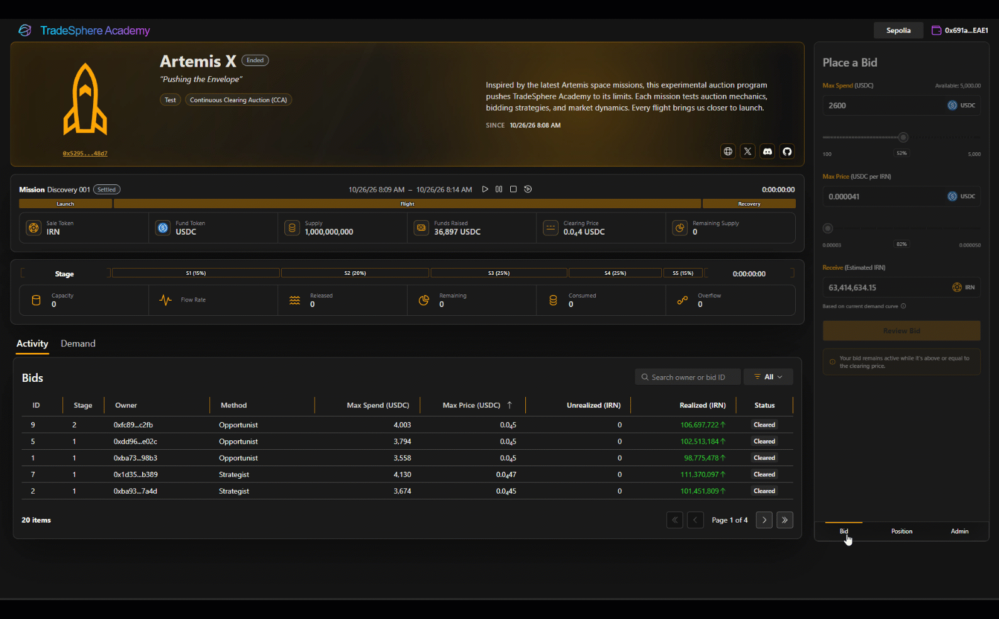

# TradeSphere Academy — Test Bots & Scenarios

## Overview

TradeSphere Academy includes an automated scenario execution framework for testing auction configurations, bidding behavior, token distribution, and clearing calculations.

**Academy test bots are controlled participants used to validate auction mechanics. They are not independent external Agents.**

Test bots operate under configurable conditions, allowing developers to observe how different bidding strategies, participant populations, and distribution schedules affect auction execution.

The framework supports three execution environments:

| Environment | Execution | Purpose |
|---|---|---|
| **Test** | Off-chain mock | Rapid simulation and scenario evaluation |
| **Sim** | On-chain testnet | Contract and transaction validation |
| **Live** | Arbitrum One mainnet | Restricted, authorized validation using real assets |

Bot configuration, scenario execution, and administration are currently restricted.

Academy also supports loading independently deployed Uniswap CCA auctions by contract address for reconstruction, monitoring, and replay. These capabilities are implemented but currently restricted to administrators.

### Test Bots vs. External Agents

TradeSphere distinguishes between internally controlled test bots and independent market participants.

| | Academy Test Bots | External Agents |
|---|---|---|
| **Purpose** | Validate auction behavior | Participate in markets and activities |
| **Control** | Academy scenario executor | Independent operators or execution systems |
| **Behavior** | Configured strategies and parameters | Independently determined |
| **Identity** | Internal player identifiers | Wallet addresses; future Aura integration |
| **Execution** | Controlled Test, Sim, or authorized Live scenarios | Public participation under applicable rules |

Academy's test bots are not presented as independent market demand.

External Agents are a separate category of participant and are not managed through Academy's testing framework.

---

## Why Test Bots?

Auction behavior depends on both the distribution configuration and the actions of participants.

A scenario with limited demand behaves differently from one with aggressive bidding, changing price ceilings, or concentrated spending commitments.

Test bots introduce controlled variation, allowing Academy to evaluate:

- Competition for available token supply
- Clearing price progression
- Bid displacement and partial allocations
- Changes in demand across stages
- Distribution and flow-rate behavior
- Different participant populations and strategies
- Checkpoint consistency and calculation accuracy
- Execution reconstruction and replay

**The objective is to evaluate auction mechanics under varied conditions, not to predict actual market demand.**

---

## Scenario Configuration

An auction scenario defines the conditions under which an auction executes.

It combines the distribution schedule with parameters controlling simulated participants and their bidding behavior.

### Configuration Parameters

| Parameter | Purpose |
|---|---|
| **Allocation** | Total token supply assigned to the auction |
| **Distribution** | Supply allocation across stages |
| **Flow** | Rate at which tokens become available |
| **Stages / Steps** | Intervals with defined distribution characteristics |
| **Duration (Config)** | Total auction operating period; defined in auction Config |
| **Floor Price (Config)** | Minimum clearing price; defined in auction Config |
| **Bidder Count** | Number of automated participants |
| **Bid Timing** | When bots may submit bids |
| **Bidder Behavior** | Strategies and behavioral profiles |

Configurations can be evaluated through Test and then validated through Sim before authorized Live execution.

### Scenario Types

Academy supports several starting configurations:

| Scenario | Description |
|---|---|
| **UnderSubscribed** | Demand remains below available supply |
| **Balanced** | Demand and supply are more closely aligned |
| **Competitive** | Multiple participants compete for allocations |
| **LateSurge** | Increased bidding activity toward the end |
| **WhalePressure** | Larger spending commitments influence clearing |
| **PriceLadder** | Participants use different price ceilings |
| **Custom** | Project-defined scenario parameters |

These scenarios provide repeatable starting conditions for evaluating different auction configurations.

---

## Test Bot Participants

Academy models test bots as players with an identity, auction context, and configurable bidding behavior.

Each bot operates within the scenario's economic and execution constraints.

### Behavioral Modeling

The framework supports five bidding strategies:

| Strategy | General Behavior |
|---|---|
| **Conservative** | Lower price tolerance and cautious spending |
| **Regular** | Moderate participation within configured limits |
| **Aggressive** | Greater willingness to bid at higher prices |
| **Reactive** | Responds to changing auction conditions |
| **Whale** | Models larger spending commitments and concentrated demand |

Academy also incorporates personality-inspired behavioral modeling based on the sixteen Myers-Briggs types.

These profiles are organized into four temperament groups:

| Temperament | Personality Types |
|---|---|
| **Strategist (NT)** | INTJ, INTP, ENTJ, ENTP |
| **Guardian (SJ)** | ISTJ, ISFJ, ESTJ, ESFJ |
| **Opportunist (SP)** | ISTP, ISFP, ESTP, ESFP |
| **Idealist (NF)** | INFJ, INFP, ENFJ, ENFP |

Each temperament defines numerical behavioral parameters:

- **Participation Bias:** Influences the tendency to participate.
- **Price Sensitivity:** Influences responses to price conditions.
- **Spend Sensitivity:** Influences spending behavior.

These models introduce configurable behavioral variation rather than relying entirely on identical scripted bidders.

Personality types are used as simulation constructs, not psychological assessments or predictions of actual investor behavior.

**The behavioral framework is intentionally extensible**, allowing more sophisticated decision-making strategies to be introduced without changing the underlying scenario execution model.

### Participant Identification

Test bots receive internal player identifiers and descriptive labels.

These identifiers allow Academy to associate bids with the originating automated participant, reconstruct activity, and evaluate behavioral differences.

The current identification model is independent of TradeSphere's planned Aura identity and reputation integration.

### System-Managed Transactions

Academy uses Nethereum to execute transactions through managed accounts.

Depending on the scenario and auction state, supported operations include:

- Bid submission
- Bid exits
- Token and refund claims

Transactions submitted by test bots are subject to the same underlying smart contract rules as other participants.

Their purpose, however, remains testing and validation rather than independent market participation.

---

## Bid Timing & Competition

Submitting every automated bid simultaneously produces a different competitive environment from distributing bids over time.

Academy supports configuring bot participation astage auction stages and execution intervals.

### Stage-Based Participation

Test bots can be constrained by stage-specific participation rules.

For example, a scenario may allow each bot to submit one bid per stage.

This limits bidding frequency while still allowing competition to develop as additional bids enter the auction.

### Randomized Submission Windows

Bots can submit bids at randomized times within configured intervals.

This produces variation in:

- Bid arrival order
- Available supply at submission
- Current clearing price
- Competing allocations
- Bid displacement

Randomization helps exercise auction behavior under different transaction sequences.

### Bidding Constraints

Automated participants operate within configurable limits, including available budget, maximum acceptable price, bid frequency, behavioral strategy, and auction state.

These parameters support controlled experiments and comparisons across scenario executions.

---

## Execution Environments

Academy's scenario framework supports progressively more realistic execution conditions.

### Test — Mock Execution

Test runs the auction model off-chain without deploying contracts or submitting blockchain transactions.

Scenarios can execute at configurable speeds, allowing developers to evaluate lengthy auctions quickly.

Test supports:

- Automated participant populations
- Configurable bidding strategies
- Randomized submission timing
- Auction flow and clearing calculations
- Bid competition and allocation analysis
- Replay and verification

A scenario can be cloned from Test into Sim for blockchain validation.

### Sim — Testnet Execution

Sim uses actual smart contracts and blockchain transactions on test networks such as Ethereum Sepolia.

Test bots submit real testnet transactions using test accounts and test assets.

This validates transaction execution, contract interaction, clearing, settlement, and claims alongside Academy's application calculations.

Scenarios can be cloned from Sim into Live using the appropriate network and asset configuration.

### The Discovery Auction — Public Test Auction

The Discovery auction is Gridiron's initial public qualification
auction, operating on **Ethereum Sepolia** using **test USDC and test IRN**.

An extended participation window accommodates a broad range of
participants, while minimum and maximum bidder requirements
establish the qualification boundaries.

Unlike accelerated Test scenarios, the Discovery auction operates
on a live blockchain with actual transactions, clearing, and
settlement using test assets.

Academy provides test USDC once per wallet, immediately before
the participant's first bid. Connecting a wallet alone does not
establish qualification.

The Discovery auction must satisfy its participation requirements
before the campaign can advance to the Confidence phase.

**Controlled test bots and independent public participants serve
different purposes.** Public qualification is intended to
demonstrate genuine community interest and participation.

**[Explore the Gridiron Auction](https://academy.tradesphere.org/gridiron)**

### Live — Arbitrum One Mainnet Execution

Live operates against Arbitrum One mainnet smart contracts using real assets.

Academy's test bot infrastructure can support restricted, explicitly authorized Arbitrum One mainnet validation when necessary.

**Test bots are not intended to impersonate organic market demand or operate as undisclosed participants in public auctions.**

Independent participants, including external Agents, are separate from Academy's managed test infrastructure.

Replay and verification remain available for Live auction execution.

---

## Replay & Reconstruction

*Replay at speed showing auction stages, price discovery, and allocation changes. Replay is an implemented administrator-only capability.*

Academy supports reconstructing auction activity and re-evaluating execution results.

This is especially valuable for automated scenarios, where numerous bids can affect clearing prices and allocations.

Replay supports analysis of:

- Bid submission sequences
- Competition across stages
- Clearing price progression
- Realized and unrealized allocations
- Token distribution and checkpoints
- Settlement calculations
- Differences between reconstructed and recorded execution

### Virtual & On-Chain Comparison

Academy's calculation services can reconstruct auction execution and compare results against observed contract state.

This helps identify discrepancies involving pricing, allocations, checkpoints, or settlement.

### Reproducibility

Scenario configuration, behavioral assignments, and recorded auction activity provide a basis for reproducing execution conditions.

Where randomized timing affects participation, recorded transaction sequences support accurate reconstruction.

Replay is therefore both an analytical tool and a means of validating the auction execution model.

### Existing Uniswap CCA Auctions

Academy can load existing Uniswap CCA auctions by deployed contract address, including auctions created independently of Academy.

Once loaded, the application can reconstruct the auction configuration and execution state from blockchain records and checkpoints.

These auctions can be:

- Monitored as they execute on-chain
- Examined using Academy's auction and token flow visualizations
- Reconstructed from recorded execution data
- Replayed using Academy's calculation engine
- Analyzed by comparing reconstructed results against recorded blockchain state

This capability extends Academy's monitoring and replay functionality beyond auctions created through its own registration and scenario workflows.

**Existing-auction loading, live monitoring, and replay are implemented but currently restricted to administrators.**

[Detailed Auction Mechanics](auction.md)

---

## TheQuickening — Example Scenario

**TheQuickening** is an Academy auction scenario used for Gridiron execution and validation.

It distributes token supply across five stages, with changing flow rates and automated bidding activity.

| Stage | Supply Allocation | Relative Flow |
|---|---:|---|
| 1 | 15% | Slowest |
| 2 | 20% | Slow |
| 3 | 25% | Medium |
| 4 | 25% | Fast |
| 5 | 15% | Fastest |

The flow-rate progression is intentional. Stage durations differ, so flow is determined by **both the token allocation and the duration of each stage**.

A stage with a smaller allocation can have a higher flow rate if its duration is sufficiently shorter.

### Automated Participation

The scenario supports a population of test bots assigned different behavioral profiles.

Bots can participate according to configured constraints, including bidding frequency, spending budgets, and randomized timing within stages.

As the auction progresses:

- Tokens become available at the configured flow rate.
- Bots submit bids under their behavioral and economic constraints.
- Clearing prices respond to qualifying demand.
- Competitive bids can displace current unrealized allocations.
- Completed stages establish realized fills.
- Replay reconstructs and verifies the resulting execution.

TheQuickening can be evaluated through off-chain Test execution and on-chain Sim validation.

Its value is not simply the number of automated participants, but the ability to observe how varied bidding behavior interacts with a changing distribution schedule.

---

## Current Availability & Future Direction

Academy's test bots, behavioral models, scenario execution, external CCA loading, and replay capabilities are implemented and currently restricted to administrative use.

The broader TradeSphere platform already supports scenarios and automated participants. Its bots are actively executing **Ideas, Missions, and Games** through the existing activity framework.

Academy builds on this foundation with a more sophisticated behavioral model, incorporating bidding strategies, Myers-Briggs personality profiles, temperaments, and configurable behavioral biases.

These enhancements are designed to be reusable across TradeSphere's existing scenario infrastructure.

Future integration can extend behavioral modeling beyond auctions into other activities, allowing automated participants to exhibit more varied strategies, decisions, and reactions.

The distinction remains important:

- **Test Bots:** Controlled participants used for simulation, testing, and validation.
- **TradeSphere Bots:** Existing automated participants operating within TradeSphere activities and scenarios.
- **External Agents:** Independently operated participants interacting with TradeSphere through supported interfaces.

**Academy advances the behavioral model. TradeSphere provides the broader activity environment in which that model can operate.**

---

## Related Documentation

- [TradeSphere Academy](https://academy.tradesphere.org)
- [Gridiron Discovery Auction](https://academy.tradesphere.org/gridiron)
- [Architecture](architecture.md)
- [Auction Mechanics](auction.md)
- [Technology Stack](technology.md)
- [Rewards & Qualification](rewards.md)
- [Uniswap CCA](https://developers.uniswap.org/docs/liquidity/liquidity-launchpad/overview)