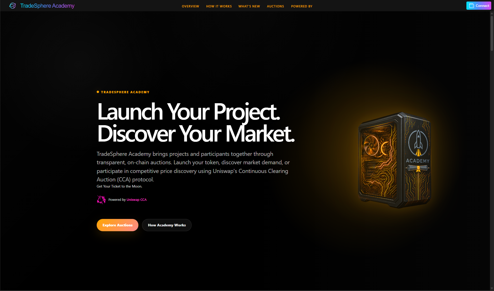

# TradeSphere Academy — Technology Stack

## Overview

TradeSphere Academy is built with **.NET 10, Blazor Server, Fluent UI Blazor 5, Nethereum, Reown, and Uniswap Continuous Clearing Auctions (CCA)**.

The architecture combines C# application services, Ethereum smart contracts, connected wallets, automated execution, and real-time market visualization.

Rather than building a proprietary auction protocol, Academy uses Uniswap CCA and develops the supporting infrastructure for auction configuration, execution, monitoring, simulation, and replay.

Academy can also connect to existing Uniswap CCA auctions by contract address, including independently deployed auctions, for live monitoring and replay.

Academy operates as a standalone application, with domain models and services designed for future integration into the broader TradeSphere platform.

---

## Core Technologies

| Technology | Role |
|---|---|
| **.NET 10 / C#** | Domain models, application services, auction calculations, and execution |
| **Blazor Server** | Interactive UI and server-managed application state |
| **Fluent UI Blazor 5** | Component framework and design system |
| **Nethereum** | Ethereum integration, contract operations, and managed transactions |
| **Reown** | Browser wallet connectivity and participant-authorized transactions |
| **Uniswap CCA** | On-chain token distribution, clearing, and settlement |
| **Ethereum Sepolia** | Testnet contract execution and validation |
| **Arbitrum One** | Planned mainnet auction execution and settlement |
| **Infura** | Blockchain RPC connectivity |
| **Microsoft Azure** | Application hosting |
| **GitHub** | Source management and technical documentation |

---

## .NET 10 & C#

C# is used across Academy's application architecture:

- Domain models and application services
- Auction registration and configuration
- Scenario execution and test bots
- Fixed-point pricing and token calculations
- Blockchain contract integration
- Existing CCA contract loading
- Interactive UI components
- Replay and result verification

### Strongly Typed Domain Models

Academy's models represent auctions, registrations, scenarios, bids, positions, and execution states.

These models provide a consistent foundation for application services, scenario execution, and UI presentation.

Strong typing is particularly valuable when working with blockchain values involving large integers, token decimals, contract parameters, and Q96 fixed-point prices.

---

## Blazor Server

Academy uses **Blazor Server** for its interactive application.

The server maintains the application model, coordinates blockchain monitoring, performs auction calculations, and distributes state updates to connected participants.

### Centralized Blockchain Monitoring

Rather than requiring every connected browser to independently poll the blockchain, Academy uses shared application services to observe contract state.

This approach:

- Reduces redundant RPC requests
- Maintains consistent auction information across connected sessions
- Centralizes calculation and state reconstruction
- Supports real-time presentation without continuous client-side blockchain polling

The interface can update its presentation between blockchain observations, while authoritative state remains determined by on-chain execution.

### JavaScript & Wallet Integration

Academy uses JavaScript with Reown for browser-specific wallet operations.

Participant-authorized transactions are initiated through the connected wallet, while application monitoring and calculations remain server-managed.

**The current application does not use a Blazor WebAssembly client for wallet integration.**

This separation provides the benefits of a centralized application model while retaining direct participant control over wallet authorization.

*Academy's Blazor Server application using .NET 10 and Fluent UI Blazor 5.*

---

## Fluent UI Blazor 5

Academy uses **Fluent UI Blazor 5** as its component framework.

Fluent components provide reusable controls for navigation, forms, dialogs, data presentation, and user interaction.

Academy combines these components with custom layouts and specialized market interfaces, including:

- Auction metrics and status indicators
- Bid controls and position summaries
- Token flow visualization
- Settlement information
- Administrative and scenario interfaces

The component framework provides a consistent foundation without limiting Academy's ability to implement specialized auction functionality.

Official project: [Fluent UI Blazor](https://www.fluentui-blazor.net/)

---

## Nethereum

Nethereum provides Academy's .NET integration with Ethereum-compatible networks.

It supports blockchain queries, smart contract interaction, transaction construction, and managed account execution.

### Blockchain Monitoring

Academy uses Nethereum to retrieve and interpret contract information, including:

- Auction configuration and lifecycle state
- Bids and checkpoints
- Clearing prices and funds raised
- Token allocations and settlement balances

### Managed Transactions

Nethereum supports system-managed operations such as:

- Token and auction contract creation
- Administrative transactions
- Test bot bidding
- Bid exits
- Token and refund claims

These operations use managed accounts rather than participant-connected browser wallets.

### Contract Models & Numeric Handling

Academy provides conversion and calculation utilities for token units, decimals, large integer values, and Uniswap CCA fixed-point price representations.

These calculations support contract interaction, monitoring, scenario evaluation, and replay.

### Existing Contract Integration

Academy can load existing Uniswap CCA contracts directly by address, including auctions deployed independently of Academy.

Nethereum supports the contract queries and blockchain data retrieval required to reconstruct auction configurations, checkpoints, bids, and execution state.

The loaded auctions can then use Academy's monitoring, calculation, and replay services without requiring deployment through Academy.

**Existing-auction loading and replay are implemented capabilities currently restricted to administrators.**

Official project: [Nethereum](https://nethereum.com/)

---

## Reown & Wallet Connectivity

Academy uses **Reown** for browser wallet connectivity and participant-authorized transactions.

Connected participants can:

- Connect supported wallets
- Select or switch blockchain networks
- Authorize ERC-20 allowances
- Submit auction bids
- Exit eligible bids
- Claim settlement balances

The participant authorizes transactions through their connected wallet.

### Two Transaction Paths

| Transaction Path | Technology | Responsibility |
|---|---|---|
| **Participant-authorized** | Reown / JavaScript | Wallet connection, signing, and user-approved transactions |
| **System-managed** | Nethereum / C# | Contract administration, automation, and managed-account transactions |

The distinction is based on **who authorizes the operation**, not which smart contract is being accessed.

Both paths interact with the same underlying blockchain contracts.

Official project: [Reown](https://reown.com/)

---

## Uniswap Continuous Clearing Auctions

Academy uses **Uniswap CCA** for on-chain token distribution and price discovery.

Uniswap's contracts provide bidding, clearing, allocation, and settlement mechanics.

Academy supplies the surrounding application infrastructure for configuring auctions, evaluating scenarios, monitoring execution, managing positions, and reconstructing results.

Academy also supports connecting to existing CCA contracts, extending its functionality beyond auctions created through Academy.

**The CCA contracts remain authoritative for auction execution.**

Academy's calculations support visualization, verification, and analysis without replacing the protocol's on-chain rules.

For auction mechanics and the project-defined campaign model, see [Auction Mechanics](auction.md).

Official documentation: [Uniswap CCA](https://developers.uniswap.org/docs/liquidity/liquidity-launchpad/overview)

---

## Blockchain Execution Environments

Academy supports three execution environments.

| Environment | Network | Purpose |
|---|---|---|
| **Test** | Off-chain | Mock execution and accelerated scenario evaluation |
| **Sim** | Ethereum Sepolia / testnet | Actual smart contract execution using test assets |
| **Live** | Arbitrum One | Mainnet auction transactions and economic commitments |

Scenarios can be cloned from Test to Sim and from Sim to Live, with network-specific addresses, assets, and contract configurations applied as appropriate.

### Live Discovery Validation

Academy's first public test auction is the Discovery auction,
part of Gridiron's The Reckoning campaign.

The Discovery auction operates on **Ethereum Sepolia** using
**test USDC and test IRN**, with an extended participation window
and defined minimum and maximum bidder requirements.

This provides an opportunity to validate real blockchain
transactions, competitive bidding, clearing, and settlement
while establishing the participation needed to advance to
the Confidence phase.

**[Explore the Gridiron Auction](https://academy.tradesphere.org/gridiron)**

### Automation & Replay

Academy's scenario executor supports controlled test bots with configurable bidding strategies and behavioral models.

These bots are part of Academy's testing infrastructure, not independent external Agents.

Replay reconstructs execution and compares application calculations with recorded auction results.

Replay also supports existing CCA auctions loaded directly by contract address.

Scenario administration, test bot controls, external contract loading, and replay are implemented but currently restricted to administrative use.

For stage-based behavioral models and execution details, see [Test Bots & Scenarios](bots.md).

---

## Hosting & Operations

Academy is hosted on **Microsoft Azure**.

The application coordinates Blazor Server sessions, backend services, blockchain monitoring, and RPC connectivity.

**Infura** provides Ethereum-compatible network access for contract queries and transaction operations.

Centralized blockchain observation helps reduce unnecessary RPC traffic while supporting multiple connected participants.

GitHub is used for source control, collaboration, and technical documentation.

---

## Public Availability

The public Academy application supports auction discovery, connected-wallet participation, bidding, monitoring, positions, and applicable settlement operations.

Additional capabilities are already implemented but currently restricted:

- Auction and token creation
- Existing CCA contract loading by address
- Live monitoring of externally deployed CCAs
- Scenario configuration and administration
- Automated test bot execution
- Accelerated mock testing and on-chain simulation
- Reconstruction, replay, and verification

Broader access is planned following validation of the initial Gridiron Discovery and Confidence auctions.

### Relationship to TradeSphere

Academy currently operates independently of the main TradeSphere application.

However, its architecture builds on concepts already present within TradeSphere, including scenarios, activities, and automated participants.

TradeSphere already executes Ideas, Missions, and Games through its scenario infrastructure.

Academy's specialized auction functionality and enhanced behavioral models are designed to integrate with that broader activity environment.

The applications remain separate today; deeper integration is part of the planned development direction.

---

## Engineering Principles

Academy's technology choices reflect several architectural priorities:

- **Established protocols:** Build on existing blockchain infrastructure rather than unnecessarily replacing it.
- **Strong domain modeling:** Separate economic configuration, execution, and presentation.
- **Centralized observation:** Share blockchain monitoring and calculations across connected participants.
- **Direct wallet authorization:** Keep participant transactions under their control.
- **Scenario-driven validation:** Evaluate configurations before committing to mainnet execution.
- **Observable execution:** Support monitoring, reconstruction, and replay.
- **External CCA compatibility:** Support independently deployed auctions without requiring Academy-based creation.
- **Reusable architecture:** Develop capabilities that can extend into the broader TradeSphere platform.

---

## Related Documentation

- [TradeSphere Academy](https://academy.tradesphere.org)
- [Gridiron Discovery Auction](https://academy.tradesphere.org/gridiron)
- [Architecture](architecture.md)
- [Auction Mechanics](auction.md)
- [Test Bots & Scenarios](bots.md)
- [Rewards & Qualification](rewards.md)
- [Fluent UI Blazor](https://www.fluentui-blazor.net/)
- [Nethereum](https://nethereum.com/)
- [Reown](https://reown.com/)
- [Uniswap CCA](https://developers.uniswap.org/docs/liquidity/liquidity-launchpad/overview)